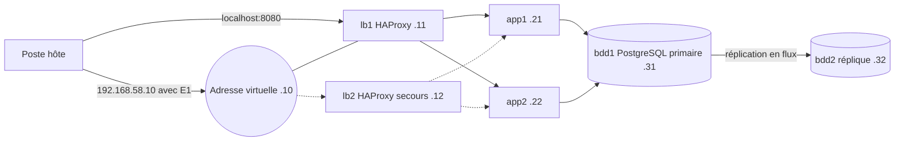

# Dossier d'architecture : RÉSULTATS-BF

Groupe 3 : ZONGO Naboswende Guy-Roland, ZANGO Issaka Wendingoudi, TAPSOBA Sandrine Pelagie, KABORE Wendpouré Julie Stéphanie.

<!-- Chaque section indique son responsable. Remplacez « À rédiger » par votre texte, dans votre branche, puis ouvrez une pull request. -->

## 1. Contexte

<!-- Responsable : Guy-Roland -->
Chaque année, le site de publication des résultats d'examens tombe dans les minutes qui suivent l'annonce. Le programme est rarement en cause : c'est l'infrastructure qui n'a été prévue ni pour un pic de consultations, ni pour survivre à la panne d'une machine.

RÉSULTATS-BF permet à un candidat de consulter son résultat à partir de son matricule. Deux exigences non fonctionnelles guident tous nos choix. La résilience : la panne d'une machine ne doit pas interrompre le service. La scalabilité : absorber plus de trafic doit se faire en ajoutant des machines, sans réécrire la configuration.

Toute l'infrastructure est décrite en code, avec Vagrant et VirtualBox. Une seule commande, `vagrant up`, la construit sur n'importe quel poste, sans geste manuel. Chaque exigence est vérifiée par un scénario scripté, dont le résultat brut est conservé dans `mesures/`. L'application est volontairement minimale : l'enjeu est l'infrastructure autour d'elle, et la preuve qu'elle tient.

## 2. Architecture

<!-- Responsable : Guy-Roland -->

L'architecture reprend le socle du sujet : deux bases PostgreSQL, bdd1 principale et bdd2 réplique en flux, N serveurs applicatifs sans état, et un répartiteur HAProxy, seul point d'entrée depuis le poste. Deux extensions s'y ajoutent : E1 double le répartiteur avec lb2 et une adresse virtuelle, et E2 ajoute une machine de supervision, obs.

**Une seule source de vérité.** Toutes les machines sont décrites dans une table du Vagrantfile : nom, adresse, mémoire, rôle et, pour les répartiteurs, adresse virtuelle et priorité. À chaque commande Vagrant, cette table est écrite dans `config/noeuds.yml`, que tous les scripts de provisionnement lisent. Aucune adresse n'est donc écrite en dur dans les scripts : changer NB_APP ou activer une extension modifie la table, et tout le reste suit.

**Un provisionnement en deux temps.** Chaque machine exécute d'abord `scripts/commun.sh`, puis le script de son rôle : `bdd.sh`, `replique.sh`, `app.sh`, `lb.sh` ou `obs.sh`. Les machines démarrent dans l'ordre de la table : les bases d'abord, le répartiteur en dernier.

**Les secrets.** Le fichier `.env`, qui contient les mots de passe, n'est jamais versionné (R7). Le Vagrantfile le crée au premier `vagrant up` à partir de `.env.exemple`, avec des mots de passe aléatoires, et le complète si le modèle gagne une variable. La reconstruction ne demande donc aucune intervention (R1).

### 2.1 Plan d'adressage

Le sujet attribue au groupe 3 le réseau privé 192.168.58.0/24 : le troisième octet vaut 55 plus le numéro du groupe. Chaque rôle a sa propre plage d'adresses, ce qui laisse de la place pour grandir et permet de reconnaître le rôle d'une machine à son adresse.

| Machine     | Rôle                                      | Adresse                       | Mémoire       | Statut |
|-------------|-------------------------------------------|-------------------------------|---------------|--------|
|             | Adresse virtuelle partagée par lb1 et lb2 | 192.168.58.10                 |               | E1     |
| lb1         | Répartiteur actif                         | 192.168.58.11                 | 512 Mo        | Socle  |
| lb2         | Répartiteur de secours                    | 192.168.58.12                 | 512 Mo        | E1     |
| app1 … appN | Serveurs applicatifs                      | 192.168.58.21 à 192.168.58.29 | 512 Mo chacun | Socle  |
| bdd1        | Base principale                           | 192.168.58.31                 | 768 Mo        | Socle  |
| bdd2        | Réplique en flux                          | 192.168.58.32                 | 768 Mo        | Socle  |
| obs         | Supervision                               | 192.168.58.41                 | 768 Mo        | E2     |

Le socle occupe 3 072 Mo avec deux serveurs applicatifs, et 4 352 Mo avec E1 et E2.

NB_APP est limité de 2 à 9 : un dixième serveur prendrait l'adresse .30, et un onzième celle de bdd1. Le Vagrantfile refuse toute autre valeur.

Seul lb1 expose un port vers le poste : le port 8080 du poste est renvoyé vers le port 80 de lb1 (R8). Tout le reste passe par le réseau privé : les serveurs applicatifs écoutent sur le port 8000, les bases sur le port 5432. Avec E1, le service est aussi joignable sur l'adresse virtuelle, http://192.168.58.10, qui reste valable si lb1 tombe. Vagrant ajoute de lui-même une redirection SSH pour chaque machine, mais elle n'écoute que sur 127.0.0.1 et ne sert qu'à l'administration.

## 3. Justification des choix

### 3.1 Répartition de charge et redondance du répartiteur (E1)

<!-- Responsable : Guy-Roland -->
**HAProxy, à tour de rôle.** Le répartiteur distribue les requêtes à tour de rôle entre les serveurs applicatifs. Sa configuration est engendrée par `lb.sh` à partir de `config/noeuds.yml` : une ligne `server` par nœud de rôle app, sans aucune adresse écrite en dur, comme l'exige le sujet pour R3.

**Une configuration qui suit NB_APP.** Le script du répartiteur est rejoué à chaque `vagrant up`, grâce à l'option `run: "always"` du Vagrantfile. Après `NB_APP=4 vagrant up`, les répartiteurs se reconfigurent donc tout seuls avec quatre serveurs. Le script valide la nouvelle configuration avec `haproxy -c`, la compare à l'actuelle, et ne recharge HAProxy que si elle a changé (R2). La valeur de NB_APP est mémorisée dans `.vagrant/nb_app`, pour que les commandes suivantes, comme `vagrant ssh` ou `vagrant destroy`, voient les mêmes machines que le dernier `vagrant up`.

**Une sonde de santé rapide.** HAProxy interroge `/sante` sur chaque serveur toutes les secondes, avec un délai d'une seconde. Deux échecs consécutifs écartent le serveur, deux succès le réintègrent : un serveur en panne est écarté en deux secondes environ, sous la limite de cinq secondes (R4). Les options `redispatch` et `retries 2` renvoient vers un autre serveur une requête dont la connexion a échoué, ce qui limite les erreurs vues par les clients pendant ce délai. Quand plus aucun serveur ne répond, HAProxy renvoie lui-même une page 503.

**Observation.** Une page d'état, sur le port 8404 de chaque répartiteur, montre en direct l'état de chaque serveur. Le port 8405 expose les mêmes informations au format Prometheus, pour l'extension E2.

**E1 : supprimer le dernier point de défaillance unique.** Avec un seul répartiteur, la panne de lb1 coupe tout le service. lb2 tourne en permanence avec la même configuration HAProxy, et keepalived partage entre les deux l'adresse virtuelle 192.168.58.10 grâce au protocole VRRP. lb1, de priorité 150, porte l'adresse. lb2, de priorité 100, la reprend dès que lb1 cesse de s'annoncer. Les deux répartiteurs s'annoncent chaque seconde, et keepalived surveille aussi HAProxy : si HAProxy s'arrête sur lb1, lb1 abandonne l'adresse, même si la machine reste allumée.

Trois choix de mise en œuvre :

- lb1 et lb2 communiquent en unicast, d'adresse à adresse, parce que le multicast fonctionne mal sur les réseaux privés de VirtualBox ;
- l'interface du réseau privé est détectée à partir de l'adresse de la machine, car son nom dépend de la boîte utilisée : c'est `eth1` dans nos machines ;
- l'adresse virtuelle, les priorités et l'adresse de l'autre répartiteur sont lues dans la table des nœuds, si bien que lb2 utilise le même `lb.sh` que lb1.

**Des extensions activables.** La variable EXTENSIONS, mémorisée comme NB_APP, choisit les extensions actives. Les extensions réalisées sont actives par défaut, pour qu'un simple `vagrant up` reconstruise la plateforme entière. `EXTENSIONS= vagrant up` démarre le socle seul, ce que le sujet recommande pendant le développement.

### 3.2 Application

<!-- Responsable : Issaka -->
À rédiger.

### 3.3 Base de données et réplication

La base est PostgreSQL 16 (paquet Ubuntu 24.04), sur deux machines : bdd1 (192.168.58.31) est le primaire en lecture et écriture, bdd2 (192.168.58.32) en est une réplique en flux, promouvable. Les choix et leurs raisons :

- **Réplication en flux avec `pg_basebackup -R`.** La copie initiale se fait depuis le primaire en marche, sans l'arrêter. L'option `-R` écrit `standby.signal` et la connexion au primaire : bdd2 démarre directement en réplique, sans geste manuel (R1). Une écriture sur bdd1 est lisible sur bdd2 (R5).
- **Un rôle de réplication dédié.** `REPLICATION_USER` n'a que le droit de répliquer, et `pg_hba.conf` ne l'autorise que depuis bdd2. L'utilisateur de l'application n'est autorisé que depuis le réseau privé, en `scram-sha-256`.
- **Aucun secret dans le dépôt (R7).** Les mots de passe viennent de `.env`, transmis par le Vagrantfile. Dans le SQL ils sont lus avec `\getenv` de psql, donc absents des arguments de commande, et passés à `pg_basebackup` par `PGPASSWORD`.
- **Le mot de passe n'est donné qu'à la création du rôle.** Un `ALTER ROLE` à chaque passage recalculerait l'empreinte du mot de passe et modifierait la base à chaque `vagrant provision` : l'idempotence (R2) serait perdue.
- **Configuration dans `conf.d`, et bloc balisé dans `pg_hba.conf`.** Le fichier `conf.d/10-resultats-bf.conf` est entièrement géré par le script ; il n'est réécrit, avec un redémarrage, que s'il change. Les règles d'accès forment un bloc entre deux repères, remplacé à chaque exécution : jamais de ligne en double. Les adresses sont lues dans `config/noeuds.yml`, la même source que le Vagrantfile : rien n'est écrit en dur.
- **Un jeu de données reproductible.** La table `resultats` (`matricule` en clé primaire) reçoit 50 000 lignes par `generate_series`, seulement si elle est vide. Les valeurs sont calculées sans `random()`, pour que les mesures soient reproductibles.
- **Un marqueur contre l'effacement d'une base promue.** Après une promotion, `standby.signal` disparaît ; sans protection, un `vagrant provision bdd2` viderait la base promue. Un fichier marqueur, créé après la copie, l'interdit.
- **bdd2 est configurée comme bdd1** (écoute sur toutes les interfaces, mêmes règles pour l'application) afin que les serveurs applicatifs puissent s'y connecter après une bascule. Les données restent dans `/var/lib/postgresql`, jamais dans un dossier synchronisé.

### 3.4 Observabilité (E2)

<!-- Responsable : Stéphanie -->
L'extension E2 ajoute une machine `obs` (192.168.58.41) qui supervise la plateforme avec Prometheus, node_exporter et Grafana.

- **node_exporter** est installé sur chaque machine virtuelle et expose son processeur, sa mémoire, son disque et son réseau.
- **Prometheus** interroge régulièrement chaque machine (modèle « pull »). Il n'y a rien à configurer sur les serveurs observés en dehors de l'agent, et une machine qui s'arrête se voit au relevé suivant : la collecte échoue et la métrique `up` passe à 0.
- **Grafana** affiche ces séries dans un tableau de bord.

Le tableau de bord doit montrer deux choses : le débit qui monte pendant une charge (V3), et un serveur applicatif qui disparaît pendant une panne (V2).

[À CONFIRMER après réalisation : l'indicateur de débit retenu (trafic réseau du répartiteur via node_exporter, ou statistiques HAProxy), et l'adresse de la machine `obs`.]

Contrainte : `obs` demande 768 Mo de mémoire. Sur un poste de 8 Go, l'extension n'est allumée que pour la démonstration.

## 4. Procédures d'exploitation

### 4.1 Ajout d'un serveur applicatif

<!-- Responsable : Guy-Roland -->
**Ajouter des serveurs.** Une seule valeur change : `NB_APP=4 vagrant up`. Vagrant crée app3 et app4 et les provisionne comme les autres. Les répartiteurs rejouent ensuite `lb.sh`, qui régénère la configuration de HAProxy avec quatre serveurs. Aucun fichier n'est modifié à la main.

Pour vérifier, `scenarios/v1.sh` doit montrer les quatre serveurs dans la répartition, et la page d'état http://192.168.58.11:8404 doit les afficher à l'état UP.

La valeur 4 est mémorisée : les commandes suivantes, même sans variable, voient toujours quatre serveurs. NB_APP accepte les valeurs de 2 à 9, et chaque serveur ajouté demande 512 Mo de mémoire.

**Retirer des serveurs.** L'ordre compte. Il faut d'abord détruire les serveurs en trop, tant que la valeur 4 est mémorisée : `vagrant destroy -f app3 app4`. Ensuite, `NB_APP=2 vagrant up` reconfigure les répartiteurs avec deux serveurs. Dans l'ordre inverse, Vagrant ne connaîtrait plus app3 et app4, qui resteraient allumées sans être gérées.

Le retrait ne gêne pas les clients, puisque les serveurs ne gardent aucun état : HAProxy les écarte dès que leur sonde échoue.

### 4.2 Bascule de la base

**Quand l'utiliser.** bdd1 ne répond plus : `/sante` renvoie 503. bdd2 doit tourner ; bdd1 peut être éteinte.

1. Depuis la racine du dépôt, dans Git Bash : `bash scripts/bascule.sh` (sous PowerShell : `& "C:\Program Files\Git\bin\bash.exe" scripts/bascule.sh`).
2. Le script vérifie que bdd2 est une réplique (`pg_is_in_recovery()` vaut `t`). Si elle est déjà principale, il le dit et s'arrête sans erreur.
3. Il promeut bdd2 avec `SELECT pg_promote()`, puis attend que `pg_is_in_recovery()` renvoie `f`.
4. Il écrit l'adresse de bdd2 (192.168.58.32) dans `config/primaire`, fichier ignoré par Git que doit lire `scripts/app.sh` pour faire pointer les serveurs applicatifs vers la nouvelle base.
5. Il affiche la durée totale.

**Durée mesurée.** 26,5 s avec seulement bdd1 et bdd2 allumées ; 34,5 s dans le scénario V4, avec toute la plateforme. Ces durées comprennent trois appels `vagrant ssh` depuis l'hôte, qui coûtent chacun plusieurs secondes sous Windows. La promotion elle-même n'a pas été chronométrée séparément.

**Relancer le script** est sans danger : bdd2 étant déjà principale, il répond qu'il n'y a rien à faire.

**Faire relire la nouvelle adresse aux serveurs applicatifs.** Dans la version actuelle de `scripts/app.sh`, le fichier `config/primaire` n'est pas encore lu : les serveurs applicatifs continuent de viser bdd1 après la bascule et `/sante` reste en 503 (voir V4). Cette étape sera décrite quand la partie applicative aura été fusionnée.

**Remettre la plateforme dans son état normal.** bdd1 ne redevient pas une réplique toute seule. Il faut supprimer `config/primaire`, puis recréer les deux bases : `vagrant destroy -f bdd1 bdd2`, puis `vagrant up bdd1 bdd2`. Le retour des serveurs applicatifs vers bdd1 dépendra de la même lecture de `config/primaire` et sera décrit avec la partie applicative. Si `vagrant up` échoue avec `VERR_ALREADY_EXISTS`, VirtualBox a laissé un dossier : supprimer `resultats-bf-bdd1` (ou `resultats-bf-bdd2`) dans le dossier `VirtualBox VMs` de l'utilisateur, puis relancer.

### 4.3 Reconstruction complète

<!-- Responsable : Stéphanie -->
**Prérequis.** VirtualBox 7.1.18 et Vagrant 2.4.9, mêmes versions pour tout le groupe. Le fichier `.env` n'a pas à être créé à la main : le Vagrantfile le crée au premier `vagrant up` à partir de `.env.exemple`, avec des mots de passe aléatoires, qui ne sont jamais versionnés (R7).

**Procédure.**
1. `vagrant destroy -f` détruit toutes les machines.
2. `vagrant up` recrée et provisionne l'ensemble, sans intervention manuelle (R1).
3. `curl http://localhost:8080/sante` permet de vérifier la plateforme.

**Mesure.** Le script `scenarios/v5.sh` enchaîne ces commandes, chronomètre l'ensemble et enregistre le résultat brut dans `mesures/v5-DATE.txt`, avec le contexte (commit, NB_APP, extensions actives). Durée mesurée : [À COMPLÉTER avec la mesure finale].

**Points d'attention.**
- La durée dépend des extensions actives et du poste : elle est notée en tête de chaque mesure.
- Les scripts doivent garder des fins de ligne LF (voir `.gitattributes`), sinon ils échouent dans les machines virtuelles.

## 5. Résultats des scénarios

<!-- Un tableau par scénario. Le fichier brut correspondant est dans mesures/. -->

### V1 : répartition de la charge

<!-- Responsable : Stéphanie -->

| Commande | Attendu | Obtenu | Verdict |
|----------|---------|--------|---------|
|          |         |        |         |

### V2 : panne d'un serveur applicatif

<!-- Responsable : Stéphanie -->

| Commande | Attendu | Obtenu | Verdict |
|----------|---------|--------|---------|
| `vagrant halt app1` pendant une charge | Service disponible, plus d'erreur au-delà de 5 s | à mesurer | à mesurer |

### V3 : montée en charge

<!-- Responsable : Stéphanie -->

| Commande | Attendu | Obtenu | Verdict |
|----------|---------|--------|---------|
| `scenarios/v3.sh` avec NB_APP=2 puis NB_APP=4 | Débit plus élevé avec 4 serveurs (sans forcément doubler : les machines virtuelles partagent un seul processeur) | à mesurer | à mesurer |

### V4 : panne de la base

| Commande | Attendu | Obtenu | Verdict |
|----------|---------|--------|---------|
| `bash scenarios/v4.sh` (départ) | `/sante` renvoie 200 | 200 | conforme |
| `vagrant halt bdd1` | bdd1 arrêtée | arrêtée en 57,9 s | conforme |
| Sondes de `/sante` toutes les 0,5 s | 503 non vide, jamais de page blanche ni d'erreur de connexion | 114 sondes : 114 en 503 non vide, 0 anomalie | conforme |
| `bash scripts/bascule.sh` | bdd2 promue, adresse dans `config/primaire` | promue en 34,5 s (26,5 s avec 2 VM) | conforme |
| Retour du 200 sur `/sante` | 200 après la bascule | non observé en 60 s | non conforme (en attente de la partie app) |

### V5 : reconstruction

<!-- Responsable : Stéphanie -->

| Commande | Attendu | Obtenu | Verdict |
|----------|---------|--------|---------|
| `scenarios/v5.sh` | Plateforme fonctionnelle sans intervention, durée totale mesurée | à mesurer | à mesurer |

### V6 : panne du répartiteur (E1)

<!-- Responsable : Stéphanie -->

| Commande | Attendu | Obtenu | Verdict |
|----------|---------|--------|---------|
| `vagrant halt lb1` | Service joignable à la même adresse en moins de 5 s | à mesurer | à mesurer |

## 6. Limites connues et ce que nous ferions autrement

<!-- Responsables : tous, une ou deux limites chacun -->
**Base de données**

- **Pas de slot de réplication.** `pg_basebackup` n'en crée pas : si bdd2 reste éteinte assez longtemps, bdd1 recycle ses journaux et la réplique ne peut plus rattraper son retard ; il faut alors la recopier entièrement. Un slot évite cela, mais fait grossir les journaux de bdd1 si la réplique ne revient jamais, jusqu'à remplir son disque. Nous avons choisi la simplicité, sans mesurer le délai après lequel la réplique décroche.
- **bdd1 ne redevient pas une réplique après la bascule.** Si elle redémarrait telle quelle, deux bases se croiraient principales. Nous remettons l'état normal en recréant bdd1 et bdd2 (voir 4.2). Nous ferions autrement avec un script de retour qui resynchronise l'ancienne base depuis la nouvelle (`pg_rewind` ou nouvelle copie).

**Répartition et infrastructure**

- **Des arrêts de machines lents.** Sur nos postes, `vagrant halt` prend 60 à 70 secondes : l'arrêt propre n'aboutit pas, et Vagrant force l'extinction au bout d'une minute. La panne survient pendant l'extinction, et les scénarios la mesurent à ce moment-là : les résultats n'en sont pas faussés. Mais V4 et V6 durent une minute de plus. Avec plus de temps, nous chercherions quel service bloque l'arrêt, ou nous réduirions le délai d'attente de Vagrant.
- **Une sonde sensible à la charge du poste.** La sonde de HAProxy attend une seconde. Sur un poste chargé, nous avons observé des réponses de `/sante` jusqu'à 1,45 s : sous forte charge, un serveur sain pourrait être écarté à tort. Nous ne l'avons pas constaté sur la machine des mesures, où `/sante` répond en 20 ms environ. Pour aller plus loin, nous ajusterions le délai de la sonde et le nombre de fils d'exécution de gunicorn d'après les mesures de V3.
- **Un accès depuis le poste qui dépend de lb1.** La redirection `localhost:8080` passe par lb1 seul : si lb1 tombe, elle tombe avec lui. Seule l'adresse virtuelle d'E1 survit à la panne. En production, c'est cette adresse virtuelle, ou un nom DNS qui pointe vers elle, qu'on publierait.

À rédiger : limites de l'application et des essais (une ou deux chacun).