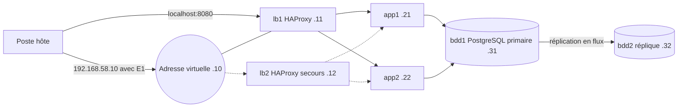

# Dossier d'architecture : RÉSULTATS-BF

Groupe 3 : ZONGO Naboswende Guy-Roland, ZANGO Issaka Wendingoudi, TAPSOBA Sandrine Pelagie, KABORE Wendpouré Julie Stéphanie.

<!-- Chaque section indique son responsable. Remplacez « À rédiger » par votre texte, dans votre branche, puis ouvrez une pull request. -->

## 1. Contexte

<!-- Responsable : Guy-Roland -->
À rédiger.

## 2. Architecture

<!-- Responsable : Guy-Roland -->

### 2.1 Plan d'adressage

À rédiger.

## 3. Justification des choix

### 3.1 Répartition de charge et redondance du répartiteur (E1)

<!-- Responsable : Guy-Roland -->
À rédiger.

### 3.2 Application

<!-- Responsable : Issaka -->
À rédiger.

### 3.3 Base de données et réplication

La base est PostgreSQL 16 (paquet Ubuntu 24.04), sur deux machines : bdd1 (192.168.58.31) est le primaire en lecture et écriture, bdd2 (192.168.58.32) en est une réplique en flux, promouvable. Les choix et leurs raisons :

- **Réplication en flux avec `pg_basebackup -R`.** La copie initiale se fait depuis le primaire en marche, sans l'arrêter. L'option `-R` écrit `standby.signal` et la connexion au primaire : bdd2 démarre directement en réplique, sans geste manuel (R1). Une écriture sur bdd1 est lisible sur bdd2 (R5).
- **Un rôle de réplication dédié.** `REPLICATION_USER` n'a que le droit de répliquer, et `pg_hba.conf` ne l'autorise que depuis bdd2. L'utilisateur de l'application n'est autorisé que depuis le réseau privé, en `scram-sha-256`.
- **Aucun secret dans le dépôt (R7).** Les mots de passe viennent de `.env`, transmis par le Vagrantfile. Dans le SQL ils sont lus avec `\getenv` de psql, donc absents des arguments de commande, et passés à `pg_basebackup` par `PGPASSWORD`.
- **Le mot de passe n'est donné qu'à la création du rôle.** Un `ALTER ROLE` à chaque passage recalculerait l'empreinte du mot de passe et modifierait la base à chaque `vagrant provision` : l'idempotence (R2) serait perdue.
- **Configuration dans `conf.d`, et bloc balisé dans `pg_hba.conf`.** Le fichier `conf.d/10-resultats-bf.conf` est entièrement géré par le script ; il n'est réécrit, avec un redémarrage, que s'il change. Les règles d'accès forment un bloc entre deux repères, remplacé à chaque exécution : jamais de ligne en double. Les adresses sont lues dans `config/noeuds.yml`, la même source que le Vagrantfile : rien n'est écrit en dur.
- **Un jeu de données reproductible.** La table `resultats` (`matricule` en clé primaire) reçoit 50 000 lignes par `generate_series`, seulement si elle est vide. Les valeurs sont calculées sans `random()`, pour que les mesures soient reproductibles.
- **Un marqueur contre l'effacement d'une base promue.** Après une promotion, `standby.signal` disparaît ; sans protection, un `vagrant provision bdd2` viderait la base promue. Un fichier marqueur, créé après la copie, l'interdit.
- **bdd2 est configurée comme bdd1** (écoute sur toutes les interfaces, mêmes règles pour l'application) afin que les serveurs applicatifs puissent s'y connecter après une bascule. Les données restent dans `/var/lib/postgresql`, jamais dans un dossier synchronisé..

### 3.4 Observabilité (E2)

<!-- Responsable : Stéphanie -->
L'extension E2 ajoute une machine `obs` (192.168.58.41) qui supervise la plateforme avec Prometheus, node_exporter et Grafana.

- **node_exporter** est installé sur chaque machine virtuelle et expose son processeur, sa mémoire, son disque et son réseau.
- **Prometheus** interroge régulièrement chaque machine (modèle « pull »). Il n'y a rien à configurer sur les serveurs observés en dehors de l'agent, et une machine qui s'arrête se voit immédiatement : la collecte échoue et la métrique `up` passe à 0.
- **Grafana** affiche ces séries dans un tableau de bord.

Le tableau de bord doit montrer deux choses : le débit qui monte pendant une charge (V3), et un serveur applicatif qui disparaît pendant une panne (V2).

[À CONFIRMER après réalisation : l'indicateur de débit retenu (trafic réseau du répartiteur via node_exporter, ou statistiques HAProxy), et l'adresse de la machine `obs`.]

Contrainte : `obs` demande 768 Mo de mémoire. Sur un poste de 8 Go, l'extension n'est allumée que pour la démonstration.

## 4. Procédures d'exploitation

### 4.1 Ajout d'un serveur applicatif

<!-- Responsable : Guy-Roland -->
À rédiger.

### 4.2 Bascule de la base

**Quand l'utiliser.** bdd1 ne répond plus : `/sante` renvoie 503. bdd2 doit tourner ; bdd1 peut être éteinte.

1. Depuis la racine du dépôt, dans Git Bash : `bash scripts/bascule.sh` (sous PowerShell : `& "C:\Program Files\Git\bin\bash.exe" scripts/bascule.sh`).
2. Le script vérifie que bdd2 est une réplique (`pg_is_in_recovery()` vaut `t`). Si elle est déjà principale, il le dit et s'arrête sans erreur.
3. Il promeut bdd2 avec `SELECT pg_promote()`, puis attend que `pg_is_in_recovery()` renvoie `f`.
4. Il écrit l'adresse de bdd2 (192.168.58.32) dans `config/primaire`, fichier ignoré par Git que doit lire `scripts/app.sh` pour faire pointer les serveurs applicatifs vers la nouvelle base.
5. Il affiche la durée totale.

**Durée mesurée.** 26,5 s avec seulement bdd1 et bdd2 allumées ; 34,5 s dans le scénario V4, avec toute la plateforme. Ces durées comprennent trois appels `vagrant ssh` depuis l'hôte, qui coûtent chacun plusieurs secondes sous Windows. La promotion elle-même n'a pas été chronométrée séparément.

**Relancer le script** est sans danger : bdd2 étant déjà principale, il répond qu'il n'y a rien à faire.
**Faire relire la nouvelle adresse aux serveurs applicatifs.** Dans la version actuelle de `scripts/app.sh`, le fichier `config/primaire` n'est pas encore lu : les serveurs applicatifs continuent de viser bdd1 après la bascule et `/sante` reste en 503 (voir V4). Cette étape sera décrite quand la partie applicative aura été fusionnée.

**Remettre la plateforme dans son état normal.
** bdd1 ne redevient pas une réplique toute seule. Il faut supprimer `config/primaire`, puis recréer les deux bases : `vagrant destroy -f bdd1 bdd2`, puis `vagrant up bdd1 bdd2`. Le retour des serveurs applicatifs vers bdd1 dépendra de la même lecture de `config/primaire` et sera décrit avec la partie applicative.. Si `vagrant up` échoue avec `VERR_ALREADY_EXISTS`, VirtualBox a laissé un dossier : supprimer `resultats-bf-bdd1` (ou `resultats-bf-bdd2`) dans le dossier `VirtualBox VMs` de l'utilisateur, puis relancer.
### 4.3 Reconstruction complète

<!-- Responsable : Stéphanie -->
**Prérequis.** VirtualBox 7.1.18 et Vagrant 2.4.9 (mêmes versions pour tout le groupe), et un fichier `.env` créé à partir de `.env.exemple`. Les mots de passe ne sont jamais versionnés (R7).

**Procédure.**
1. `vagrant destroy -f` détruit toutes les machines.
2. `vagrant up` recrée et provisionne l'ensemble, sans intervention manuelle.
3. `curl http://localhost:8080/sante` permet de vérifier la plateforme.

**Mesure.** Le script `scenarios/v5.sh` enchaîne ces commandes, chronomètre l'ensemble et enregistre le résultat brut dans `mesures/v5-DATE.txt`, avec le contexte (commit, NB_APP, extensions actives). Durée mesurée : [À COMPLÉTER avec la mesure finale].

**Points d'attention.**
- La durée dépend des extensions actives et du poste : elle est notée en tête de chaque mesure.
- Les scripts doivent garder des fins de ligne LF (voir `.gitattributes`), sinon ils échouent dans les machines virtuelles.

## 5. Résultats des scénarios

<!-- Un tableau par scénario. Le fichier brut correspondant est dans mesures/. -->

### V1 : répartition de la charge

<!-- Responsable : Guy-Roland -->

| Commande | Attendu | Obtenu | Verdict |
|----------|---------|--------|---------|
|          |         |        |         |

### V2 : panne d'un serveur applicatif

<!-- Responsable : Stéphanie -->

| `vagrant halt app1` pendant une charge | Service disponible, plus d'erreur au-delà de 5 s | à mesurer | à mesurer |

### V3 : montée en charge

<!-- Responsable : Stéphanie -->

| `scenarios/v3.sh` avec NB_APP=2 puis NB_APP=4 | Débit plus élevé avec 4 serveurs (sans forcément doubler : les machines virtuelles partagent un seul processeur) | à mesurer | à mesurer |

### V4 : panne de la base

| Commande | Attendu | Obtenu | Verdict |
|----------|---------|--------|---------|
| `bash scenarios/v4.sh` (départ) | `/sante` renvoie 200 | 200 | conforme |
| `vagrant halt bdd1` | bdd1 arrêtée | arrêtée en 57,9 s | conforme |
| Sondes de `/sante` toutes les 0,5 s | 503 non vide, jamais de page blanche ni d'erreur de connexion | 114 sondes : 114 en 503 non vide, 0 anomalie | conforme |
| `bash scripts/bascule.sh` | bdd2 promue, adresse dans `config/primaire` | promue en 34,5 s (26,5 s avec 2 VM) | conforme |
| Retour du 200 sur `/sante` | 200 après la bascule | non observé en 60 s | non conforme (en attente de la partie app) |

### V5 : reconstruction

<!-- Responsable : Stéphanie -->

| `scenarios/v5.sh` | Plateforme fonctionnelle sans intervention, durée totale mesurée | à mesurer | à mesurer |

### V6 : panne du répartiteur (E1)

<!-- Responsable : Stéphanie -->

| `vagrant halt lb1` | Service joignable à la même adresse en moins de 5 s | à mesurer | à mesurer |

## 6. Limites connues et ce que nous ferions autrement

<!-- Responsables : tous, une ou deux limites chacun -->
**Base de données**

- **Pas de slot de réplication.** `pg_basebackup` n'en crée pas : si bdd2 reste éteinte assez longtemps, bdd1 recycle ses journaux et la réplique ne peut plus rattraper son retard ; il faut alors la recopier entièrement. Un slot évite cela, mais fait grossir les journaux de bdd1 si la réplique ne revient jamais, jusqu'à remplir son disque. Nous avons choisi la simplicité, sans mesurer le délai après lequel la réplique décroche.
- **bdd1 ne redevient pas une réplique après la bascule.** Si elle redémarrait telle quelle, deux bases se croiraient principales. Nous remettons l'état normal en recréant bdd1 et bdd2 (voir 4.2). Nous ferions autrement avec un script de retour qui resynchronise l'ancienne base depuis la nouvelle (`pg_rewind` ou nouvelle copie).

À rédiger : limites de l'application, du répartiteur et des essais (une ou deux chacun).