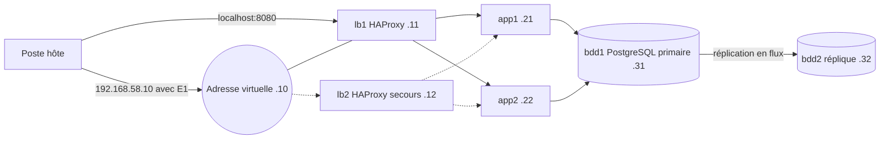

# Dossier d'architecture : RÉSULTATS-BF

Groupe 3 : ZONGO Naboswende Guy-Roland, ZANGO Issaka Wendingoudi, TAPSOBA Sandrine Pelagie, KABORE Wendpouré Julie Stéphanie.

<!-- Chaque section indique son responsable. Remplacez « À rédiger » par votre texte, dans votre branche, puis ouvrez une pull request. -->

## 1. Contexte

<!-- Responsable : Guy-Roland -->
À rédiger.

## 2. Architecture

<!-- Responsable : Guy-Roland -->

### 2.1 Plan d'adressage

À rédiger.

## 3. Justification des choix

### 3.1 Répartition de charge et redondance du répartiteur (E1)

<!-- Responsable : Guy-Roland -->
À rédiger.

### 3.2 Application

<!-- Responsable : Issaka -->
À rédiger.

### 3.3 Base de données et réplication

<!-- Responsable : Sandrine -->
À rédiger.

### 3.4 Observabilité (E2)

<!-- Responsable : Stéphanie -->
À rédiger.

## 4. Procédures d'exploitation

### 4.1 Ajout d'un serveur applicatif

<!-- Responsable : Guy-Roland -->
À rédiger.

### 4.2 Bascule de la base

<!-- Responsable : Sandrine -->
À rédiger.

### 4.3 Reconstruction complète

<!-- Responsable : Stéphanie -->
À rédiger.

## 5. Résultats des scénarios

<!-- Un tableau par scénario. Le fichier brut correspondant est dans mesures/. -->

### V1 : répartition de la charge

<!-- Responsable : Guy-Roland -->

| Commande | Attendu | Obtenu | Verdict |
|----------|---------|--------|---------|
|          |         |        |         |

### V2 : panne d'un serveur applicatif

<!-- Responsable : Stéphanie -->

| Commande | Attendu | Obtenu | Verdict |
|----------|---------|--------|---------|
|          |         |        |         |

### V3 : montée en charge

<!-- Responsable : Stéphanie -->

| Commande | Attendu | Obtenu | Verdict |
|----------|---------|--------|---------|
|          |         |        |         |

### V4 : panne de la base

<!-- Responsable : Sandrine -->

| Commande | Attendu | Obtenu | Verdict |
|----------|---------|--------|---------|
|          |         |        |         |

### V5 : reconstruction

<!-- Responsable : Stéphanie -->

| Commande | Attendu | Obtenu | Verdict |
|----------|---------|--------|---------|
|          |         |        |         |

### V6 : panne du répartiteur (E1)

<!-- Responsable : Stéphanie -->

| Commande | Attendu | Obtenu | Verdict |
|----------|---------|--------|---------|
|          |         |        |         |

## 6. Limites connues et ce que nous ferions autrement

<!-- Responsables : tous, une ou deux limites chacun -->
À rédiger.
